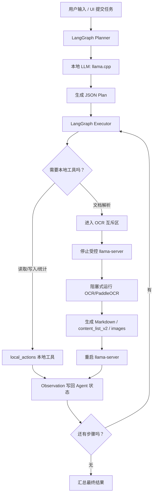

# 离线边缘端 LangGraph Agent

这是一个用于验证“边缘端 Agent 调度业务逻辑”的本地项目。当前版本以 WSL Ubuntu 作为测试环境，默认使用 `llama.cpp` 启动本地 `llama-server`，模型规划和执行由 LangGraph 编排，文档解析由 OCR/PaddleOCR 作为互斥重型工具执行。

## 目前实现了什么

- 本地 Agent 主链路：用户输入 -> Planner 生成计划 -> Executor 执行 ReAct 步骤 -> 本地工具返回 Observation -> 汇总结果。
- LLM 后端：
  - 唯一后端：`llama.cpp`。
  - Python 进程会启动和管理 `llama-server`，并通过 `/v1/chat/completions` 调用。
  - 已移除 `mock` 和 `ollama` 后端；测试通过 patch llama.cpp 调用完成，不再提供运行时 mock。
- 严格串行重型资源管理：
  - LLM 推理和 OCR 解析互斥。
  - 调 OCR 前会终止受控的 `llama-server`。
  - OCR 阻塞式运行结束后，再重新拉起 `llama-server`。
  - 子进程通过进程组管理，超时或异常时会先终止、再强杀、最后等待回收。
- 本地工具：
  - 读取技能文件。
  - 读取/写入 `workspace_files/` 下的文本文件。
  - 统计文本字符数。
  - 调用 OCR/PaddleOCR 解析 PDF、图片。
- Web UI：
  - 居中的聊天框。
  - 拖拽/点击上传文件。
  - 展示执行状态、Agent 步骤和 Observation。
  - 右侧“可用功能”快捷按钮。
  - 左下角任务记录。
  - 左上角自建/编辑 `skill.md` 窗口。
  - 右下角会议记录开关与语音输入按钮。

## Agent 能干什么

当前适合做这些事情：

- 读取本地安全工作区内的文本文件。
- 统计输入文本字符数。
- 查看和学习本地 Markdown 技能。
- 上传文件到 `workspace_files/uploads/`。
- 对支持格式的文档调用 OCR/PaddleOCR，生成 Markdown、`content_list_v2`、图片目录等解析产物。
- 在 UI 中快速触发“文件读取”“文件解析”“列出技能”等任务。

当前还不适合做这些事情：

- 还没有完整的多轮长期记忆。
- 还没有向量检索和大文档分块问答。
- UI 使用 SSE 展示任务事件，但工具步骤仍是 MVP 粒度。
- OCR_pc 依赖需要按 `OCR_pc/OCR_pc/requirements.txt` 准备。
- `llama.cpp` 和 Qwen GGUF 需要先单独下载/构建。
- 没有用户权限系统，不建议直接暴露到公网。

## 运行流程图



## 命令行使用

第一次准备 `llama.cpp` 和 Qwen2.5-1.5B GGUF：

```powershell
wsl -u root --cd /mnt/c/Users/19653/Desktop/agent bash scripts/ensure_llama_cpp_wsl.sh
```

运行 Agent：

```powershell
cd C:\Users\19653\Desktop\agent
.\scripts\run_agent_wsl.cmd "请读取 demo_input.txt，并总结内容。"
```

## Web UI 使用

启动 UI：

```powershell
.\scripts\run_agent_ui_wsl.cmd
```

浏览器打开：

```text
http://127.0.0.1:7860
```

界面说明：

- 中间：聊天框和上传区。
- 右侧：可用功能，点击“文件读取/文件解析”会弹出文件选择窗口，上传后自动填充 prompt 并发送。
- 左上：自建 `skill.md` 编辑器，可以读取、修改、保存技能文件。
- 左下：任务记录，记录最近的处理结果。
- 聊天结果下方：显示 Agent 执行步骤，包括 Action、Action Input 和 Observation。

## 文档解析使用说明

把文件放进 `workspace_files/`，或在 UI 中上传文件。然后使用类似 prompt：

```text
请使用 PARSE_DOCUMENT_WITH_OCR_PC 解析文件 uploads/sample.pdf，返回 Markdown、content_list_v2、图片目录，并总结解析结果。
```

工具会返回：

- `markdown_path`
- `content_list_v2_path`
- `blocks_json_path`
- `images_dir`
- `checkpoint_dir`
- `markdown_preview`
- `log_path`

RDK 板端使用 syss + BPU PaddleOCR 流水线时，保持工具名不变，启动前配置：

```bash
export AGENT_OCR_BACKEND=syss
export SYSS_PROJECT_DIR=/home/sunrise/syss/syss_f16yolo
```

如果不用外部 syss 项目，而是走本仓库内置 `sys_core.syss`，再配置：

```bash
export SYSS_BPU_RUNTIME_DIR=/home/sunrise/rdk_model_zoo/samples/vision/PaddleOCR/runtime/python
export SYSS_BPU_DET=/home/sunrise/rdk_model_zoo/samples/vision/PaddleOCR/model/en_PP-OCRv3_det_640x640_nv12.bin
export SYSS_BPU_REC=/home/sunrise/rdk_model_zoo/samples/vision/PaddleOCR/model/rec_ppocr_cn.bin
export SYSS_BPU_DICT=/home/sunrise/rdk_model_zoo/samples/vision/PaddleOCR/runtime/python/dict.txt
```

外部 syss 项目的 fp16 YOLO、BPU OCR、LayoutReader 路径由它自己的 `config.py` 管。内置路线下，DocLayout-YOLO 识框第一版继续使用 CPU ONNX；如果模型不在默认目录，用 `SYSS_YOLO_MODEL` 指定。BPU OCR 默认会在后台和 YOLO 阶段重叠执行；如需关闭，可设 `SYSS_BPU_OVERLAP=0`。

如果不需要 Agent 的资源锁和 UI 链路，只想在板端一次命令完成 OCR，可直接跑：

```bash
bash scripts/run_syss_ocr_once.sh -i workspace_files/uploads/demo.pdf -o workspace_files/ocr_outputs
```

这个脚本会调用 `agent_edge.syss_ocr_once`，输出同样的 `*_ocr_result.json`、Markdown、blocks、content_list_v2。注意：one-shot 脚本不会自动停止 `llama-server`，需要在资源充足或 LLM 已停时使用。

## 重要约束

- 重型引擎必须串行：`llama-server` 和 OCR 不能同时活跃。
- 不要在 UI 中并发提交多个重型任务。
- 大 PDF 不要一次性塞进模型上下文，后续应接入分块摘要/检索。
- 当前运行必须准备 `llama.cpp` 和 Qwen2.5-1.5B GGUF；没有无模型 mock 模式。
- `.runtime/` 用于放 llama.cpp 和模型，不进入 git。
- `OCR_pc/`、`sherpa_asr/` 是外部能力目录，模型和虚拟环境不应进入 git。
