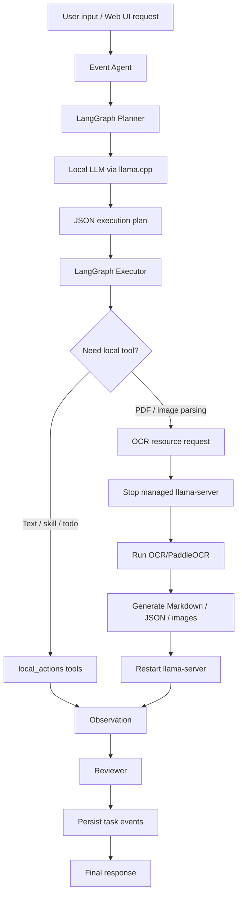

# Offline Edge LangGraph Agent

Offline Edge LangGraph Agent is a local-first agent system designed for desktop and edge-device deployment. It uses LangGraph for task orchestration, `llama.cpp` for local OpenAI-compatible LLM inference, and integrates local tools for OCR/PaddleOCR document parsing, meeting transcription, file operations, task scheduling, and document export.

The project is built to run useful agent workflows without relying on cloud services. Its current primary environment is Windows with WSL Ubuntu, with additional integration paths for RDK/board-side OCR pipelines.

## Key Features

- Local agent workflow: user input -> Planner -> Executor with ReAct steps -> local tool Observation -> Reviewer -> final response.
- Local LLM backend: managed `llama-server` process powered by `llama.cpp` and accessed through OpenAI-compatible `/v1/chat/completions`.
- Web UI: chat, file upload, task event streaming, model selection, context management, OCR records, meeting records, voice input, and schedule/todo views.
- Document parsing: OCR/PaddleOCR parsing for PDFs and images, producing Markdown, `content_list_v2`, blocks JSON, image directories, and logs.
- Local file tools: safe read/write/count operations inside the controlled `workspace_files/` directory.
- Meeting workflow: meeting recording/transcription status, meeting summary generation, and Typst-based meeting minutes export.
- Schedule/todo workflow: lightweight local task storage and a `/todo` page.
- Heavy-runtime scheduling: mutual exclusion for LLM, OCR, and ASR workloads so that high-resource processes do not compete unexpectedly.

## Repository Structure

```text
.
+-- agent_edge/                 # Core Python package
|   +-- graph.py                # LangGraph Planner/Executor workflow
|   +-- event_agent.py          # Async tasks, event stream, and context assembly
|   +-- web_app.py              # HTTP Web UI and API server
|   +-- llm.py                  # Local LLM call wrapper
|   +-- heavy_runtime.py        # llama.cpp, OCR, and ASR resource scheduling
|   +-- local_actions.py        # Local tool registry and dispatcher
|   +-- ocr_pc_tool.py          # PC OCR/PaddleOCR tool entry point
|   +-- syss_ocr_runner.py      # RDK/syss OCR integration
|   +-- meeting_asr.py          # Meeting recording and voice input management
|   +-- meeting_formatter.py    # Meeting minutes formatting and export
|   +-- task_store.py           # Agent task and event persistence
|   +-- todo_store.py           # Schedule/todo persistence
|   +-- ui/                     # Packaged UI assets
+-- skills/                     # Local Skill.md capability descriptions
+-- scripts/                    # WSL, llama.cpp, UI, and OCR helper scripts
+-- sys_core/                   # Built-in syss/OCR implementation
+-- sherpa_asr/                 # sherpa-onnx ASR-related assets and utilities
+-- todo_rdk/                   # Schedule/todo frontend and data
+-- workspace_files/            # Controlled workspace, uploads, and outputs
+-- docs/                       # Architecture, deployment, and migration docs
+-- tests/                      # Unit tests
+-- pyproject.toml              # Python package configuration
+-- requirements.txt            # Python dependencies
+-- index.html                  # Main Web UI page
+-- schedule.html               # Schedule page
+-- README_CN.md                # Chinese README
```

## Runtime Flow



## Requirements

- Python 3.10 or later.
- Windows with WSL Ubuntu, or a Linux environment capable of running Python and `llama.cpp`.
- A built `llama-server` binary.
- A local GGUF model. The default model alias is `qwen2.5-1.5b-instruct-q4_k_m`.
- OCR/PaddleOCR runtime dependencies for document parsing.
- Typst for PDF export in meeting-minutes workflows.

## Installation

Create and activate a Python virtual environment:

```powershell
cd C:\Users\19653\Desktop\agent
python -m venv .venv
.\.venv\Scripts\Activate.ps1
python -m pip install --upgrade pip
python -m pip install -r requirements.txt
python -m pip install -e .
```

Prepare `llama.cpp` and the default GGUF model from WSL:

```powershell
wsl -u root --cd /mnt/c/Users/19653/Desktop/agent bash scripts/ensure_llama_cpp_wsl.sh
```

If you already have a `llama-server` binary or a GGUF model, override the defaults with environment variables:

```powershell
$env:LLAMA_CPP_BIN="C:\path\to\llama-server.exe"
$env:LLAMA_CPP_MODEL_PATH="C:\path\to\model.gguf"
$env:LLAMA_CPP_MODEL="your-model-alias"
```

## CLI Usage

Run one agent task through the WSL helper:

```powershell
.\scripts\run_agent_wsl.cmd "Read demo_input.txt and summarize the main content."
```

After installing the package in editable mode, you can also use the Python entry point:

```powershell
edge-agent "Count the number of characters in this sentence."
```

Common options:

```powershell
edge-agent `
  --model qwen2.5-1.5b-instruct-q4_k_m `
  --model-path .runtime\models\qwen2.5-1.5b-instruct-q4_k_m.gguf `
  --base-url http://127.0.0.1:8080/v1 `
  --threads 4 `
  --ctx-size 4096 `
  --show-trace `
  "Read demo_input.txt and show the execution trace."
```

## Web UI

Start the Web UI:

```powershell
.\scripts\run_agent_ui_wsl.cmd
```

Open:

```text
http://127.0.0.1:7860
```

The UI includes:

- Main chat panel for natural-language tasks.
- File upload into `workspace_files/uploads/`.
- Task event stream for Planner, tool calls, OCR, Reviewer, and completion events.
- Model management for discovering and selecting `.gguf` models.
- Context management for document and business contexts.
- OCR records for recently generated Markdown outputs.
- Meeting controls for recording, summarization, and meeting-minutes export.
- Schedule/todo page at `/todo`.

## Document Parsing

Place files under `workspace_files/` or upload them from the Web UI. Then use a prompt such as:

```text
Use PARSE_DOCUMENT_WITH_OCR_PC to parse uploads/sample.pdf. Return Markdown, content_list_v2, image directory, block count, and a summary of the parsing result.
```

The OCR tool typically returns:

- `markdown_path`
- `content_list_v2_path`
- `blocks_json_path`
- `images_dir`
- `checkpoint_dir`
- `markdown_preview`
- `log_path`

For a direct board-side or command-line syss OCR run:

```bash
bash scripts/run_syss_ocr_once.sh -i workspace_files/uploads/demo.pdf -o workspace_files/ocr_outputs
```

This invokes `agent_edge.syss_ocr_once` and produces the same categories of OCR artifacts as the Agent path. The one-shot script does not automatically stop `llama-server`, so use it when resources are available or the LLM server is already stopped.

## RDK / syss OCR Configuration

For an external syss + BPU PaddleOCR pipeline:

```bash
export AGENT_OCR_BACKEND=syss
export SYSS_PROJECT_DIR=/home/sunrise/syss/syss_f16yolo
```

For the built-in `sys_core.syss` path, configure the actual board-side runtime paths:

```bash
export SYSS_BPU_RUNTIME_DIR=/home/sunrise/rdk_model_zoo/samples/vision/PaddleOCR/runtime/python
export SYSS_BPU_DET=/home/sunrise/rdk_model_zoo/samples/vision/PaddleOCR/model/en_PP-OCRv3_det_640x640_nv12.bin
export SYSS_BPU_REC=/home/sunrise/rdk_model_zoo/samples/vision/PaddleOCR/model/rec_ppocr_cn.bin
export SYSS_BPU_DICT=/home/sunrise/rdk_model_zoo/samples/vision/PaddleOCR/runtime/python/dict.txt
```

The external syss project manages fp16 YOLO, BPU OCR, and LayoutReader paths through its own `config.py`. For the built-in path, set `SYSS_YOLO_MODEL` if the DocLayout-YOLO model is not in the default location. Set `SYSS_BPU_OVERLAP=0` to disable overlapping BPU OCR execution with the YOLO stage.

## Local Tools

The Agent exposes local tools through `agent_edge.local_actions`. Common tools include:

- `LIST_SKILLS`: list local skill files.
- `SAFE_READ_TEXT_FILE`: read a small text file inside `workspace_files/`.
- `SAFE_WRITE_TEXT_FILE`: write a text file inside `workspace_files/`.
- `COUNT_TEXT_CHARS`: count text characters.
- `PARSE_DOCUMENT_WITH_OCR_PC`: parse a PDF or image document.
- `READ_LAST_OCR_RESULT`: read the latest OCR Markdown result.
- `EXPORT_OCR_SUMMARY`: export a summary document from OCR Markdown.
- `FORMAT_MEETING_MINUTES`: format meeting transcripts as Markdown/Typst/PDF.
- `LIST_TODO_TASKS`, `ADD_TODO_TASK`, `UPDATE_TODO_TASK`, `COMPLETE_TODO_TASK`, `DELETE_TODO_TASK`: manage schedule/todo items.

All default file read/write tools are constrained to `workspace_files/` to prevent accidental access outside the controlled workspace.

## Important Environment Variables

| Variable | Default | Description |
| --- | --- | --- |
| `AGENT_RUNTIME_DIR` | `.runtime` | Runtime directory for `llama.cpp`, models, and logs |
| `AGENT_WORKSPACE_DIR` | `workspace_files` | Controlled file workspace |
| `AGENT_SKILLS_DIR` | `skills` | Local skill directory |
| `AGENT_UI_HOST` | `127.0.0.1` | Web UI host |
| `AGENT_UI_PORT` | `7860` | Web UI port |
| `AGENT_UI_MAX_UPLOAD_BYTES` | `52428800` | Maximum upload size |
| `AGENT_MAX_LOCAL_FILE_BYTES` | `65536` | Maximum local text read/write size |
| `LLAMA_CPP_BIN` | auto-detected | Path to `llama-server` |
| `LLAMA_CPP_MODEL_PATH` | `.runtime/models/qwen2.5-1.5b-instruct-q4_k_m.gguf` | GGUF model path |
| `LLAMA_CPP_MODEL` | `qwen2.5-1.5b-instruct-q4_k_m` | Model alias |
| `LLAMA_CPP_BASE_URL` | `http://127.0.0.1:8080/v1` | Local LLM API base URL |
| `LLAMA_CPP_THREADS` | `4` | llama.cpp CPU thread count |
| `LLAMA_CPP_CTX_SIZE` | `4096` | llama.cpp context size |
| `AGENT_OCR_BACKEND` | PC OCR path | OCR backend selector |

## Testing

Run the full test suite:

```powershell
python -m pytest
```

Run a specific module:

```powershell
python -m pytest tests/test_local_actions.py
```

Some OCR, ASR, Typst, or board-side tests require external models, binaries, or hardware/runtime setup.

## Development Notes

- `.runtime/` stores local runtime files, models, and logs and should not be committed.
- `workspace_files/` stores uploads, OCR outputs, and generated documents. Manage its contents according to your deployment needs.
- `llama-server`, OCR, and ASR are heavy resources. The project uses `heavy_runtime.py` to coordinate them; avoid running multiple heavy tasks concurrently.
- The current Web UI does not include a public-facing authentication/authorization system. Do not expose it directly to the public internet.
- Large files should not be inserted directly into the model context. Prefer OCR, chunked summaries, or context retrieval workflows.

## Additional Documentation

See:

- `docs/agent/AGENT_MVP_GUIDE.md`
- `docs/agent/系统架构.md`
- `docs/agent/进程调度.md`
- `docs/agent/MEETING_MINUTES_TYPST_DEPLOY.md`
- `docs/human/系统架构.md`

## License

No open-source license is currently declared in this repository. Add an explicit License file before public release or commercial distribution.
