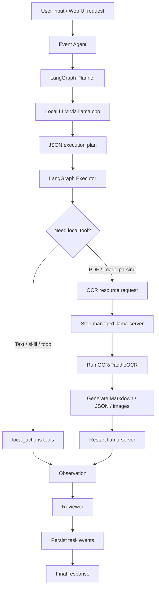

# 离线边缘端 LangGraph Agent

离线边缘端 LangGraph Agent 是一个面向本地与边缘设备部署的智能体项目。项目以 LangGraph 为任务编排核心，使用 `llama.cpp` 提供本地 OpenAI-compatible LLM 服务，并集成 OCR/PaddleOCR、会议转写、文件读写、日程待办与文档导出等本地工具能力。系统设计目标是在尽量不依赖云端服务的前提下，完成文档理解、任务规划、工具调用和可追踪的人机交互流程。

本项目当前主要运行环境为 Windows + WSL Ubuntu，也保留了面向 RDK/板端 OCR 流水线的适配路径。

## 主要能力

- 本地智能体执行链路：用户输入 -> Planner 生成计划 -> Executor 执行 ReAct 步骤 -> 本地工具返回 Observation -> Reviewer 检查结果 -> 输出最终响应。
- 本地 LLM 后端：通过 `llama.cpp` 启动并管理 `llama-server`，使用 `/v1/chat/completions` 兼容接口进行推理。
- Web UI：提供聊天、文件上传、任务事件流、模型选择、上下文管理、OCR 记录、会议记录、语音输入和日程待办入口。
- 文档解析：支持对 PDF、图片等文件调用 OCR/PaddleOCR 解析，输出 Markdown、`content_list_v2`、blocks JSON、图片目录和日志。
- 本地文件工具：在受控的 `workspace_files/` 工作区内安全读取、写入和统计文本。
- 会议能力：支持会议录音/转写状态管理、会议摘要生成，以及基于 Typst 的会议纪要导出流程。
- 日程待办：内置轻量级 todo/schedule 数据存储与 `/todo` 页面。
- 资源调度：对 LLM、OCR、ASR 等重型资源进行互斥管理，避免 `llama-server` 与 OCR 等高占用任务同时运行。

## 项目架构

```text
.
+-- agent_edge/                 # 核心 Python 包
|   +-- graph.py                # LangGraph Planner/Executor 主流程
|   +-- event_agent.py          # 异步任务、事件流与上下文装配
|   +-- web_app.py              # HTTP Web UI 与 API 服务
|   +-- llm.py                  # 本地 LLM 调用封装
|   +-- heavy_runtime.py        # llama.cpp、OCR、ASR 等重型资源调度
|   +-- local_actions.py        # 本地工具注册与执行入口
|   +-- ocr_pc_tool.py          # PC OCR/PaddleOCR 工具入口
|   +-- syss_ocr_runner.py      # RDK/syss OCR 运行适配
|   +-- meeting_asr.py          # 会议录音与语音输入管理
|   +-- meeting_formatter.py    # 会议纪要格式化与导出
|   +-- task_store.py           # Agent 任务与事件持久化
|   +-- todo_store.py           # 日程待办持久化
|   +-- ui/                     # 打包用 UI 静态资源
+-- skills/                     # 本地 Skill.md 能力说明
+-- scripts/                    # WSL、llama.cpp、UI、OCR 启动脚本
+-- sys_core/                   # 内置 syss/OCR 相关实现
+-- sherpa_asr/                 # sherpa-onnx ASR 相关能力目录
+-- todo_rdk/                   # 日程/待办前端与数据
+-- workspace_files/            # 受控工作区、上传文件与输出文件
+-- docs/                       # 架构、部署和迁移文档
+-- tests/                      # 单元测试
+-- pyproject.toml              # Python 包配置
+-- requirements.txt            # Python 依赖
+-- index.html                  # 主 Web UI 页面
+-- schedule.html               # 日程页面
+-- README.md                   # English README
```

## 运行流程



## 环境要求

- Python 3.10 或更高版本。
- Windows + WSL Ubuntu，或可直接运行 Python 与 `llama.cpp` 的 Linux 环境。
- 已构建的 `llama-server`。
- GGUF 格式本地模型，默认模型别名为 `qwen2.5-1.5b-instruct-q4_k_m`。
- 如需文档解析，需准备 OCR/PaddleOCR 运行环境。
- 如需会议纪要 PDF 导出，需安装 Typst。

## 安装

建议先创建独立 Python 虚拟环境：

```powershell
cd C:\Users\19653\Desktop\agent
python -m venv .venv
.\.venv\Scripts\Activate.ps1
python -m pip install --upgrade pip
python -m pip install -r requirements.txt
python -m pip install -e .
```

在 WSL 环境中准备 `llama.cpp` 和默认 GGUF 模型：

```powershell
wsl -u root --cd /mnt/c/Users/19653/Desktop/agent bash scripts/ensure_llama_cpp_wsl.sh
```

如果你已经有自己的 `llama-server` 或 GGUF 模型，可以通过环境变量覆盖默认路径：

```powershell
$env:LLAMA_CPP_BIN="C:\path\to\llama-server.exe"
$env:LLAMA_CPP_MODEL_PATH="C:\path\to\model.gguf"
$env:LLAMA_CPP_MODEL="your-model-alias"
```

## 命令行使用

通过项目脚本在 WSL 中运行一次 Agent 任务：

```powershell
.\scripts\run_agent_wsl.cmd "请读取 demo_input.txt，并总结主要内容。"
```

安装为本地包后，也可以直接使用命令行入口：

```powershell
edge-agent "请统计这段文字的字符数。"
```

常用参数：

```powershell
edge-agent `
  --model qwen2.5-1.5b-instruct-q4_k_m `
  --model-path .runtime\models\qwen2.5-1.5b-instruct-q4_k_m.gguf `
  --base-url http://127.0.0.1:8080/v1 `
  --threads 4 `
  --ctx-size 4096 `
  --show-trace `
  "请读取 demo_input.txt，并输出执行过程。"
```

## Web UI 使用

启动 Web UI：

```powershell
.\scripts\run_agent_ui_wsl.cmd
```

浏览器访问：

```text
http://127.0.0.1:7860
```

Web UI 提供以下入口：

- 中央聊天区：提交自然语言任务并查看最终响应。
- 文件上传区：上传文件到 `workspace_files/uploads/`，再由 Agent 读取或解析。
- 任务事件流：显示 Planner、工具调用、OCR、Reviewer 和任务完成事件。
- 模型管理：列出 `.gguf` 模型并选择当前 `llama.cpp` 模型。
- 上下文管理：查看、激活或清除文档/业务上下文。
- OCR 记录：查看最近生成的 OCR Markdown 结果。
- 会议能力：启动/停止会议录音、生成会议摘要、导出会议纪要。
- 日程待办：通过 `/todo` 页面或自然语言工具管理任务。

## 文档解析

将文件放入 `workspace_files/`，或在 Web UI 中上传。随后可以使用类似指令：

```text
请使用 PARSE_DOCUMENT_WITH_OCR_PC 解析文件 uploads/sample.pdf，返回 Markdown、content_list_v2、图片目录和文本块数量，并总结解析结果。
```

OCR 工具通常会返回：

- `markdown_path`
- `content_list_v2_path`
- `blocks_json_path`
- `images_dir`
- `checkpoint_dir`
- `markdown_preview`
- `log_path`

如果只想在板端或命令行直接执行一次 syss OCR，可使用：

```bash
bash scripts/run_syss_ocr_once.sh -i workspace_files/uploads/demo.pdf -o workspace_files/ocr_outputs
```

该脚本会调用 `agent_edge.syss_ocr_once`，输出与 Agent OCR 链路一致的 Markdown、blocks JSON、`content_list_v2` 和结果 JSON。注意：one-shot 脚本不会自动停止 `llama-server`，建议在资源充足或 LLM 已停止时使用。

## RDK / syss OCR 配置

使用外部 syss + BPU PaddleOCR 流水线时，可以设置：

```bash
export AGENT_OCR_BACKEND=syss
export SYSS_PROJECT_DIR=/home/sunrise/syss/syss_f16yolo
```

如果使用仓库内置 `sys_core.syss`，可按实际板端路径配置：

```bash
export SYSS_BPU_RUNTIME_DIR=/home/sunrise/rdk_model_zoo/samples/vision/PaddleOCR/runtime/python
export SYSS_BPU_DET=/home/sunrise/rdk_model_zoo/samples/vision/PaddleOCR/model/en_PP-OCRv3_det_640x640_nv12.bin
export SYSS_BPU_REC=/home/sunrise/rdk_model_zoo/samples/vision/PaddleOCR/model/rec_ppocr_cn.bin
export SYSS_BPU_DICT=/home/sunrise/rdk_model_zoo/samples/vision/PaddleOCR/runtime/python/dict.txt
```

外部 syss 项目的 fp16 YOLO、BPU OCR 和 LayoutReader 路径由其自身 `config.py` 管理。内置路线下，如 DocLayout-YOLO 模型不在默认目录，可通过 `SYSS_YOLO_MODEL` 指定；如需关闭 BPU OCR 与 YOLO 阶段的重叠执行，可设置 `SYSS_BPU_OVERLAP=0`。

## 本地工具

Agent 通过 `agent_edge.local_actions` 暴露本地工具，常用工具包括：

- `LIST_SKILLS`：列出本地技能文件。
- `SAFE_READ_TEXT_FILE`：读取 `workspace_files/` 内的小型文本文件。
- `SAFE_WRITE_TEXT_FILE`：写入 `workspace_files/` 内的文本文件。
- `COUNT_TEXT_CHARS`：统计文本字符数。
- `PARSE_DOCUMENT_WITH_OCR_PC`：解析 PDF 或图片文档。
- `READ_LAST_OCR_RESULT`：读取最近一次 OCR Markdown 结果。
- `EXPORT_OCR_SUMMARY`：基于 OCR Markdown 导出摘要文档。
- `FORMAT_MEETING_MINUTES`：将会议转写格式化为 Markdown/Typst/PDF。
- `LIST_TODO_TASKS`、`ADD_TODO_TASK`、`UPDATE_TODO_TASK`、`COMPLETE_TODO_TASK`、`DELETE_TODO_TASK`：管理日程待办。

所有文件读写默认限制在 `workspace_files/` 内，避免越界访问本机文件系统。

## 重要环境变量

| 变量 | 默认值 | 说明 |
| --- | --- | --- |
| `AGENT_RUNTIME_DIR` | `.runtime` | 运行时目录，存放 `llama.cpp`、模型和日志 |
| `AGENT_WORKSPACE_DIR` | `workspace_files` | 受控文件工作区 |
| `AGENT_SKILLS_DIR` | `skills` | 本地技能目录 |
| `AGENT_UI_HOST` | `127.0.0.1` | Web UI 监听地址 |
| `AGENT_UI_PORT` | `7860` | Web UI 监听端口 |
| `AGENT_UI_MAX_UPLOAD_BYTES` | `52428800` | Web UI 单次上传大小上限 |
| `AGENT_MAX_LOCAL_FILE_BYTES` | `65536` | 本地文本读写大小上限 |
| `LLAMA_CPP_BIN` | 自动查找 | `llama-server` 可执行文件路径 |
| `LLAMA_CPP_MODEL_PATH` | `.runtime/models/qwen2.5-1.5b-instruct-q4_k_m.gguf` | GGUF 模型路径 |
| `LLAMA_CPP_MODEL` | `qwen2.5-1.5b-instruct-q4_k_m` | 模型别名 |
| `LLAMA_CPP_BASE_URL` | `http://127.0.0.1:8080/v1` | 本地 LLM API 地址 |
| `LLAMA_CPP_THREADS` | `4` | llama.cpp CPU 线程数 |
| `LLAMA_CPP_CTX_SIZE` | `4096` | llama.cpp 上下文长度 |
| `AGENT_OCR_BACKEND` | PC OCR 路线 | OCR 后端选择 |

## 测试

项目包含面向 Graph、LLM 封装、本地工具、Web API、OCR runner、会议 ASR 和任务存储的测试：

```powershell
python -m pytest
```

如只验证某个模块：

```powershell
python -m pytest tests/test_local_actions.py
```

部分 OCR、ASR、Typst 或板端相关测试依赖外部模型、二进制文件或运行环境，执行前请确认对应资源已准备好。

## 开发约束

- `.runtime/` 用于放置本地运行时、模型和日志，不应提交到 Git。
- `workspace_files/` 用于用户上传、OCR 输出和文档产物，应按实际需求管理其中内容。
- `llama-server`、OCR 和 ASR 属于重型资源，项目通过 `heavy_runtime.py` 做互斥调度；不要并发启动多个高占用任务。
- 当前项目没有面向公网的用户认证和权限系统，不建议直接暴露到公网。
- 大文件不应一次性塞入模型上下文，应优先使用 OCR、分块摘要或上下文检索流程。

## 文档

更多内部说明位于：

- `docs/agent/AGENT_MVP_GUIDE.md`
- `docs/agent/系统架构.md`
- `docs/agent/进程调度.md`
- `docs/agent/MEETING_MINUTES_TYPST_DEPLOY.md`
- `docs/human/系统架构.md`

## License

当前仓库未声明开源许可证。若需要对外发布或商用，请先补充明确的 License 文件。
