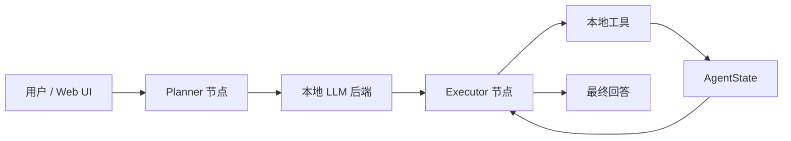
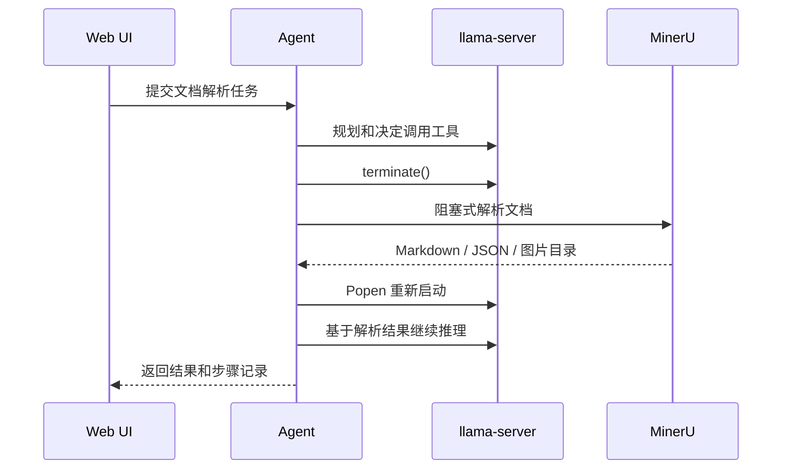

# Agent MVP 使用说明书

## 1. 项目定位

本项目是一个离线边缘端 Agent MVP。它的目标不是追求最快推理速度，而是验证一套可以在小内存设备上工作的业务调度逻辑：

- Agent 由 LangGraph 编排。
- 本地模型由 `llama.cpp` 提供。
- 文档解析由 MinerU 提供。
- LLM 推理和文档解析严格互斥，避免内存溢出。

## 2. 当前功能

### 已实现

- Planner / Executor 两节点 Agent。
- 本地 Markdown 技能系统。
- 本地工具拦截器。
- 仅保留 `llama.cpp` / `llama-server` 作为 LLM 后端。
- Python 受控启动和停止 `llama-server`。
- MinerU 阻塞式文档解析工具。
- Web UI：
  - 聊天框。
  - 文件上传。
  - Agent 执行步骤展示。
  - 任务记录。
  - 可用功能快捷入口。
  - 自建 `skill.md` 编辑窗口。

### 暂未实现

- 大文档分块检索问答。
- 流式模型输出。
- 多用户隔离。
- 权限管理和审计。
- MinerU 依赖的一键轻量化安装。
- 真实硬件上的性能调优。

## 3. 运行架构



文档解析互斥流程：



## 4. 命令行运行

准备 llama.cpp 和 Qwen2.5-1.5B GGUF：

```bash
bash scripts/ensure_llama_cpp_wsl.sh
```

运行 Agent：

```bash
bash scripts/run_wsl.sh "请读取 demo_input.txt，并总结内容。"
```

## 5. Web UI 运行

```bash
python -m agent_edge.web_app
```

默认地址：

```text
http://127.0.0.1:7860
```

在 Windows PowerShell 中也可以使用：

```powershell
.\scripts\run_agent_ui_wsl.cmd
```

常用环境变量：

- `AGENT_UI_HOST`：UI 监听地址，默认 `127.0.0.1`。
- `AGENT_UI_PORT`：UI 端口，默认 `7860`。
- `LLAMA_CPP_BIN`：`llama-server` 路径。
- `LLAMA_CPP_MODEL_PATH`：GGUF 模型路径。
- `MINERU_PROJECT_DIR`：MinerU 源码或安装目录。
- `MINERU_TIMEOUT_SECONDS`：MinerU 解析超时时间。

## 6. Web UI 操作指南

1. 打开 UI。
2. 确认 `llama-server` 和 Qwen GGUF 模型已准备好。
3. 在中间聊天框输入任务，点击发送。
4. 拖拽或点击上传区上传文件。
5. 点击右侧“文件读取”或“文件解析”，系统会弹出文件窗口，上传后自动填充 prompt 并发送。
6. 左上角可以编辑 `skills/*.md`。
7. 左下角查看最近任务记录。
8. 每次结果下方会展示 Agent 执行步骤。

## 7. 本地工具说明

所有工具只能通过 `USE_TOOL` 调用。

```json
{
  "tool_name": "SAFE_READ_TEXT_FILE",
  "args": {"path": "demo_input.txt"}
}
```

可用工具：

- `LOCAL_ECHO`
- `COUNT_TEXT_CHARS`
- `LIST_SKILLS`
- `SAFE_READ_TEXT_FILE`
- `SAFE_WRITE_TEXT_FILE`
- `PARSE_DOCUMENT_WITH_MINERU`

MinerU 调用示例：

```json
{
  "tool_name": "PARSE_DOCUMENT_WITH_MINERU",
  "args": {
    "path": "uploads/sample.pdf",
    "backend": "pipeline",
    "method": "auto",
    "output_dir": "mineru_outputs"
  }
}
```

## 8. 安全边界

- 文件读写默认限制在 `workspace_files/`。
- 技能文件默认限制在 `skills/`。
- UI 没有鉴权，不要暴露到公网。
- 文档解析和模型推理不能并行。
- 子进程由 Python 管理，异常时会清理进程组。

## 9. 推荐下一步

- 给 UI 增加流式日志和实时进度。
- 增加 Markdown 分块摘要工具。
- 增加 `content_list_v2` 检索和引用页码回答。
- 增加任务持久化，例如 SQLite。
- 给 MinerU 安装和模型下载做独立向导。
